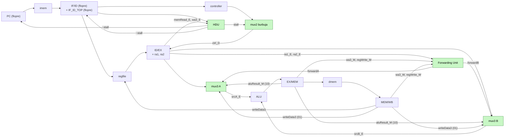
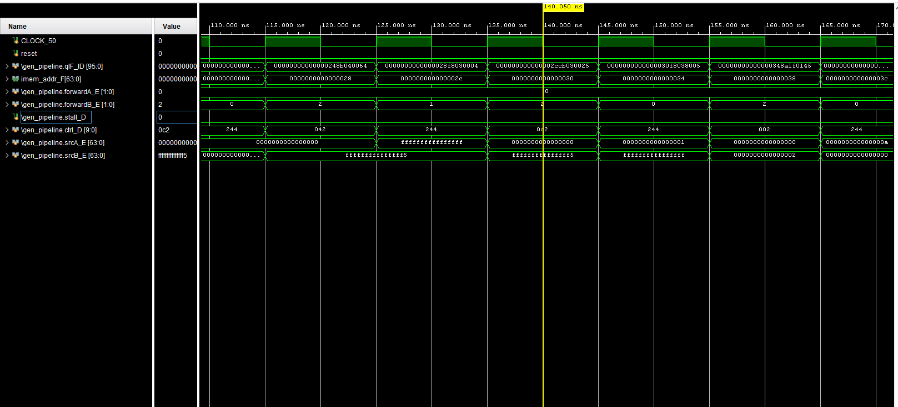
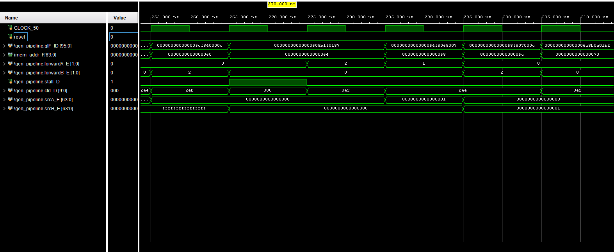

# Arquitectura de Computadoras - FAMAF - UNC

## Integrantes
- Alejo Manuel garcia
- Rafael Ceratto
- Manuel Agustin Quiroga

## Ejercicios hechos
- Ejercicio 1 (Regularidad)
- Ejercicio 2 (para Promoción)

## Lab 1: Implementación del procesador LEGv8 con pipeline de 5 etapas

## Modificaciones del Hardware Base e Instrucción MOVZ

Modificaciones introducidas para soportar la nueva instrucción MOVZ

### -maindec.sv:

 Se agregó la decodificación para el opcode de la instruccion MOVZ (110100101), se asignó un código de operación especial para la ALU, ALUOp = 11 y se configuraron las señales de control de la siguiente manera:

 MemRead = 0 para que no lea memoria

 MemWrite = 0 para que no escriba en memoria

 RegWrite = 1 para que escriba en el registro destino

 ALUSrc = 1  para dejar pasar el valor inmediato

### -aludec.sv:

 Se incorporó el caso para ALUOp = 11, instruyendo a la ALU mediante la señal ALUControl = 0111 para que deje pasar el valor inmediato dirigiéndolo directamente a la etapa de Writeback

### -signext.sv:

 Se modificó la lógica para reconocer la instrucción MOVZ. El módulo ahora extrae el valor inmediato de 16 bits de la instrucción (bits 20:5) y lo ubica en la posición correcta de un bus de 64 bits, rellenando con ceros el resto según el nivel de desplazamiento indicado por los bits de LSL (bits 22:21).

### regfile.sv:

 Para permitir el adelantamiento interno, se modificó la asignación de lectura asíncrona mediante operadores ternarios: si se detecta que la dirección de escritura (wa3) coincide con alguna de las direcciones de lectura (ra1 o ra2) mientras la señal we3 está activa, el registro emite directamente el dato entrante (wd3) en lugar del valor almacenado, evitando la lectura de un dato obsoleto. Esta lógica se alimentó utilizando el puerto wa3_D que realimenta la dirección desde la etapa Writeback hacia Decode.

 ### clkDiv.sv datapaht.sv decode.sv y processor_core.sv

 Se cambio el parametro PIPELINE=1 para que el procesador active la ejecucion en 5 etapa y asi poder simular ejecucion de instrucciones en paralelo

## Programa de prueba en ensamblador LEGv8:

 Para verificar el funcionamiento de las nuevas instrucciones y del procesador base, se utilizó el siguiente código de prueba. Se agregaron instrucciones MOVZ con distintos desplazamientos (LSL) y se usaron nops (ADD XZR, XZR, XZR) para evitar los Data Hazards y Control Hazards.

        STUR X1, [X0, #0]
        STUR X2, [X0, #8]
        STUR X3, [X16, #0]
        ADD X3, X4, X5
        AND X20, X20, X20
        ORR X6, X11, XZR
        STUR X3, [X0, #24]
        SUB X3, X4, X5
        STUR X20, [X0, #80]
        STUR X6, [X0, #88]
        STUR X3, [X0, #32]
        ORR X6, X11, X3
        SUB X4, XZR, X10
        SUB X5, X1, X3
        STUR X6, [X0, #96]
        STUR X4, [X0, #40]
        ADD X4, X3, X4
        STUR X5, [X0, #56]
        AND X5, X10, XZR
        STUR X4, [X0, #48]
        LDUR X12, [X0, #0]
        STUR X5, [X0, #64]
        AND X5, X10, X3
        ADD X7, X12, XZR
        ADD XZR, X13, X14
        STUR X12, [X0, #112]
        STUR X5, [X0, #72]
        STUR X7, [X0, #104]
        CBZ X0, L1
        ADD XZR, XZR, XZR
        ADD XZR, XZR, XZR
        ADD XZR, XZR, XZR
        STUR X21, [X0, #128]
    L1: STUR X21, [X0, #136]
        ADD X2, XZR, X1
    L2: ADD X24, XZR, X1
        ADD XZR, XZR, XZR
        SUB X2, X2, X1
        STUR X24, [X0, #144]
        ADD X0, X0, X8
        CBZ X2, L2
        ADD XZR, XZR, XZR
        ADD XZR, XZR, XZR
        ADD XZR, XZR, XZR
        STUR X30, [X0, #144]
        ADD X30, X30, X30
        MOVZ X29, #0xFFFF, LSL 00
        STUR XZR, [X0, #104]
        ADD X30, X30, X20
        STUR x29, [x0, #160]
        MOVZ X29, #0xFFFF, LSL 16
        SUB X21, XZR, X21
        LDUR X25, [X30, #-8]
        ADD X30, X30, x30
        STUR x29, [x0, #168]
        MOVZ X29, #0x7FF2, LSL 32
        ADD X30, X30, X16
        ADD XZR, XZR, XZR
        STUR x29, [x0, #176]
        MOVZ X29, #0x7FF2, LSL 48
        STUR X25, [X30, #-8]
        ADD XZR, XZR, XZR
        STUR x29, [x0, #184]
        ADD XZR, XZR, XZR
        ADD XZR, XZR, XZR
        finloop: CBZ XZR, finloop

## Juego de LEDs

Programa:
// Inicializacion:

    MOVZ X10, #0x8000        // X10 = GPIO input
    MOVZ X11, #0x8008        // X11 = GPIO output
    MOVZ X12, #0x0001        // X12 = bit para SW0
    MOVZ X14, #0x000E        // X14 = bits SW1..3
    MOVZ X17, #1             // Constante 1
    MOVZ X20, #1             // LED actual (arranca en LED0)
    MOVZ X21, #0xFFFF        // Todos prendidos
    MOVZ X22, #0x000E        // 3 switches
    MOVZ X23, #0x0002        // solo SW1
    MOVZ X24, #0x0004        // solo SW2
    MOVZ X25, #0x0008        // solo SW3
    MOVZ X26, #1             // Retardo velocidad maxima (3 switches)
    MOVZ X27, #4             // Retardo velocidad media  (2 switches)
    MOVZ X28, #8             // Retardo velocidad minima (1 switch)

loop:
    LDUR X15, [X10, #0]      // X15 = Estado actual de los switches
    ADD  XZR, XZR, XZR       // Nop
    ADD  XZR, XZR, XZR       // Nop
    AND  X1, X15, X12        // X1 = estado de SW0
    AND  X3, X15, X14        // X3 = estado de SW1..3
    ADD  XZR, XZR, XZR       // Nop
    ADD  XZR, XZR, XZR       // Nop

    CBZ  X1, sw0_es_cero
    ADD  XZR, XZR, XZR       // Nop
    ADD  XZR, XZR, XZR       // Nop
    ADD  XZR, XZR, XZR       // Nop

    CBZ  XZR, efecto_leds    // Si SW0 esta activo entonces hago el efecto
    ADD  XZR, XZR, XZR       // Nop
    ADD  XZR, XZR, XZR       // Nop
    ADD  XZR, XZR, XZR       // Nop

sw0_es_cero:
    CBZ  X3, todos_apagados  // Si no hay ningun SW de velocidad activo apago todo
    ADD  XZR, XZR, XZR       // Nop
    ADD  XZR, XZR, XZR       // Nop
    ADD  XZR, XZR, XZR       // Nop

    STUR X21, [X11, #0]      // Si hay alguno prendo todos
    CBZ  XZR, loop           // Vuelvo a chequear el estado de los siwtches
    ADD  XZR, XZR, XZR       // Nop
    ADD  XZR, XZR, XZR       // Nop
    ADD  XZR, XZR, XZR       // Nop

todos_apagados:
    STUR XZR, [X11, #0]      // Apago los leds 
    CBZ  XZR, loop           // Vuelvo a chequear el estado de los switches
    ADD  XZR, XZR, XZR       // Nop
    ADD  XZR, XZR, XZR       // Nop
    ADD  XZR, XZR, XZR       // Nop

efecto_leds:
    CBZ  X3, efecto_inicial  // Si no hay velocidad, LED0 fijo
    ADD  XZR, XZR, XZR
    ADD  XZR, XZR, XZR
    ADD  XZR, XZR, XZR

    CBZ  XZR, efecto_con_velocidad
    ADD  XZR, XZR, XZR
    ADD  XZR, XZR, XZR
    ADD  XZR, XZR, XZR

efecto_inicial:
    STUR X17, [X11, #0]      // LED0 fijo (X17 = 1)
    ADD  X20, XZR, X17       // Para que el efecto vuelva al Led0 si se desactiva la velocidad 
    CBZ  XZR, loop           // Vuelvo a chequear el estado de los switches
    ADD  XZR, XZR, XZR       // Nop
    ADD  XZR, XZR, XZR       // Nop
    ADD  XZR, XZR, XZR       // Nop

efecto_con_velocidad:
    STUR X20, [X11, #0]      // mostrar LED actual
                             // X3 estado de los SW1..3 
    SUB  X6, X3, X22         // X22 = Estan activos los 3 switches 
    SUB  X7, X3, X23         // X23 = Esta activo SW1 
    SUB  X8, X3, X24         // X24 = Esta activo SW2
    SUB  X9, X3, X25         // X25 = Esta actico SW3

    CBZ  X6, velocidad_max   // Si estan activos los 3 --> Velocidad maxima
    ADD  XZR, XZR, XZR       // Nop
    ADD  XZR, XZR, XZR       // Nop
    ADD  XZR, XZR, XZR       // Nop
    CBZ  X7, velocidad_min   // Si esta activo solo SW1 --> Velocidad minima
    ADD  XZR, XZR, XZR       // Nop
    ADD  XZR, XZR, XZR       // Nop
    ADD  XZR, XZR, XZR       // Nop
    CBZ  X8, velocidad_min   // Si esta activo solo SW2 --> Velocidad minima
    ADD  XZR, XZR, XZR       // Nop
    ADD  XZR, XZR, XZR       // Nop
    ADD  XZR, XZR, XZR       // Nop
    CBZ  X9, velocidad_min   // Si esta activo solo SW3 --> Velocidad minima
    ADD  XZR, XZR, XZR       // Nop
    ADD  XZR, XZR, XZR       // Nop
    ADD  XZR, XZR, XZR       // Nop

velocidad_med:               // En el caso que no haya saltado --> estan activos 2 switches, no importan cuales
    ADD  X16, XZR, X27       // X16 = retardo medio
    CBZ  XZR, delay_loop     // Salto al delay 
    ADD  XZR, XZR, XZR       // Nop
    ADD  XZR, XZR, XZR       // Nop
    ADD  XZR, XZR, XZR       // Nop

velocidad_max:
    ADD  X16, XZR, X26       // X16 = retardo maximo
    CBZ  XZR, delay_loop
    ADD  XZR, XZR, XZR       // Nop
    ADD  XZR, XZR, XZR       // Nop
    ADD  XZR, XZR, XZR       // Nop

velocidad_min:
    ADD  X16, XZR, X28       // X16 = retardo minimo
    ADD  XZR, XZR, XZR       // Nop
    ADD  XZR, XZR, XZR       // Nop
    ADD  XZR, XZR, XZR       // Nop

delay_loop:
    SUB  X16, X16, X17       // Voy decrementando el contador
    ADD  XZR, XZR, XZR       // Nop
    ADD  XZR, XZR, XZR       // Nop
    CBZ  X16, avanzo_leds    // Si ya termino de esperar salto 
    ADD  XZR, XZR, XZR       // Nop
    ADD  XZR, XZR, XZR       // Nop
    ADD  XZR, XZR, XZR       // Nop
    CBZ  XZR, delay_loop     // Sino sigue esperando
    ADD  XZR, XZR, XZR       // Nop
    ADD  XZR, XZR, XZR       // Nop
    ADD  XZR, XZR, XZR       // Nop

avanzo_leds:
    SUB  X6, X20, X10        // X10 = 0x8000 = bit del LED15
    ADD  XZR, XZR, XZR       // Nop
    ADD  XZR, XZR, XZR       // Nop
    CBZ  X6, reinicio_efecto // Si X6 es 0 es porque X20 era el led 15 (llego al final)
    ADD  XZR, XZR, XZR       // Nop
    ADD  XZR, XZR, XZR       // Nop
    ADD  XZR, XZR, XZR       // Nop

    ADD  X20, X20, X20       // Corro una posicion hacia la izquierda (avanzo)
    CBZ  XZR, loop           // Vuelvo al loop
    ADD  XZR, XZR, XZR       // Nop
    ADD  XZR, XZR, XZR       // Nop
    ADD  XZR, XZR, XZR       // Nop

reinicio_efecto:
    ADD  X20, XZR, X17       // vuelvo al LED0
    CBZ  XZR, loop           // Vuelvo al loop
    ADD  XZR, XZR, XZR       // Nop
    ADD  XZR, XZR, XZR       // Nop
    ADD  XZR, XZR, XZR       // Nop

 Funcionamiento:
  El programa genera un efecto de luces hacia la izquierda : un único LED encendido que se
  desplaza de LED0 al LED15 y vuelve a empezar desde LED0.
  SW0 es el switch que habilita el comienzo del efecto, mientras que SW1, SW2 y SW3 regulan su velocidad según la cantidad de ellos que estén activos (no importa cuales).

Comportamiento de los Switches :
  Ninguno activo : Todos los LEDs apagados.
  Algún SW1..SW3, sin SW0: Todos los LEDs encendidos.
  Solo SW0 : LED0 encendido fijo.
  SW0 + 1 switch de velocidad : Efecto a velocidad mínima 
  SW0 + 2 switches de velocidad : Efecto a velocidad media 
  SW0 + 3 switches de velocidad : Efecto a velocidad máxima 

  Si se desactivan todos los switches de velocidad con SW0 activo, el efecto
  vuelve a LED0 y queda en pausa.

ROM:
	Al principio la amplie a 256 porque iba a hacer un efecto mas complejo y me iba a quedar chica, pero luego de una consulta a los profes el dia 4-11 opte por hacer algo mas simple.
	De esta manera me quedaba grande de 256, y la achique a 128.

## Ejercicio 2: Hazard Detection Unit y Forwarding Unit

### Que se realizo?

**Módulos nuevos:**

flopre.sv: Flip-Flop igual a flopr pero con señal `enable`. Con enable 0 mantiene su valor. Y se usa para congelar el PC y el registro IF/ID durante un stall.

forwarding_unit.sv: Se encarga de comparar los registros que lee la instrucción en EX (`ra1_E`, `ra2_E`) con el destino de las instrucciones en MEM y WB. Genera `forwardA` y `forwardB`: `00` = valor del regfile, `10` = resultado de la ALU en MEM, `01` = dato de WB. Tiene prioridad MEM (instrucción más reciente) y nunca adelanta si el destino es XZR.

hdu.sv: Detecta el caso load-use, es decir si la instrucción en EX es un `LDUR` y su destino es igual a algún registro que lee la instrucción en ID, este activa `stall`.

mux3.sv: mux de 3 entradas para elegir el operando de la ALU.

**Módulos modificados:**

decode.sv: Se encarga de instanciar la HDU (la HDU está en la etapa ID). Nuevas entradas `memRead_E`, `wa3_E` y salidas `ra2_D`, `stall_D`.

fetch.sv: El PC pasa de `flopr` a `flopre`, con entrada `enable_F`.

datapath.sv: IF/ID pasa a `flopre`. El registro ID/EX se amplía de 271 a 281 bits para guardar Rn [280:276] y Rm/Rt [275:271]. Se instancian la forwarding unit y dos `mux3` antes de la ALU. Se agrega un `mux2` (burbuja) que pone en 0 las 10 señales de control que entran a ID/EX cuando hay stall. Nueva salida `stall`.

processor_core.sv: La parte del IF/ID que guarda el opcode para el controller (`IF_ID_TOP`) pasa a `flopre`, con `enable = ~stall`.

**Funcionamiento del stall:** 

Cuando la HDU activa `stall_D`, el PC y los registros IF/ID (`IF_ID` y `IF_ID_TOP`) reciben `enable = 0` y no cambian en el siguiente clock, así que la instrucción en ID se queda esperando un ciclo. Al mismo tiempo entra una burbuja a EX (todas las señales de control en 0). En el ciclo siguiente el `LDUR` ya está en WB y la forwarding unit le pasa el dato a la instrucción que esperaba.

### Diagrama de bloques

En verde, los módulos y señales agregados.

### Programa de verificación

Es el código de la guía en su orden original **sin los nops de datos**, más instrucciones MOVZ. Se mantienen 3 nops después de cada `CBZ`, porque el procesador resuelve los hazards de **datos** (lo que pide este ejercicio) pero no los de **control**: no descarta las instrucciones que entran al pipeline después de un salto.

    STUR X1, [X0, #0]       // MEM 0 = 0x1
    STUR X2, [X0, #8]       // MEM 1 = 0x2
    STUR X3, [X16, #0]      // MEM 2 = 0x3
    ADD  X3, X4, X5
    STUR X3, [X0, #24]      // MEM 3 = 0x9    <- forwarding desde MEM
    SUB  X3, X4, X5
    STUR X3, [X0, #32]      // MEM 4 = 0xFFFFFFFFFFFFFFFF
    SUB  X4, XZR, X10
    STUR X4, [X0, #40]      // MEM 5 = 0xFFFFFFFFFFFFFFF6
    ADD  X4, X3, X4
    STUR X4, [X0, #48]      // MEM 6 = 0xFFFFFFFFFFFFFFF5
    SUB  X5, X1, X3
    STUR X5, [X0, #56]      // MEM 7 = 0x2
    AND  X5, X10, XZR
    STUR X5, [X0, #64]      // MEM 8 = 0x0
    AND  X5, X10, X3
    STUR X5, [X0, #72]      // MEM 9 = 0xA
    AND  X20, X20, X20
    STUR X20, [X0, #80]     // MEM 10 = 0x14
    ORR  X6, X11, XZR
    STUR X6, [X0, #88]      // MEM 11 = 0xB
    ORR  X6, X11, X3
    STUR X6, [X0, #96]      // MEM 12 = 0xFFFFFFFFFFFFFFFF
    LDUR X12, [X0, #0]
    ADD  X7, X12, XZR       //                <- stall (load-use)
    STUR X7, [X0, #104]     // MEM 13 = 0x1
    STUR X12, [X0, #112]    // MEM 14 = 0x1
    ADD  XZR, X13, X14
    STUR XZR, [X0, #120]    // MEM 15 = 0x0
    CBZ  X0, L1
    ADD  XZR, XZR, XZR      // nop (control)
    ADD  XZR, XZR, XZR      // nop (control)
    ADD  XZR, XZR, XZR      // nop (control)
    STUR X21, [X0, #128]    // MEM 16 = no se ejecuta
L1: STUR X21, [X0, #136]    // MEM 17 = 0x15
    ADD  X2, XZR, X1
L2: SUB  X2, X2, X1
    ADD  X24, XZR, X1
    STUR X24, [X0, #144]    // MEM 18 = 0x1 y MEM 19 = 0x1
    ADD  X0, X0, X8
    CBZ  X2, L2
    ADD  XZR, XZR, XZR      // nop (control)
    ADD  XZR, XZR, XZR      // nop (control)
    ADD  XZR, XZR, XZR      // nop (control)
    STUR X30, [X0, #144]    // MEM 20 = 0x1E
    ADD  X30, X30, X30
    SUB  X21, XZR, X21
    ADD  X30, X30, X20
    LDUR X25, [X30, #-8]
    ADD  X30, X30, X30
    ADD  X30, X30, X16
    STUR X25, [X30, #-8]    // MEM 21 = 0xA
    MOVZ X26, #0x1234, LSL 16
    STUR X26, [X0, #176]    // MEM 24 = 0x12340000
    MOVZ X27, #0xABCD, LSL 48
    STUR X27, [X0, #184]    // MEM 25 = 0xABCD000000000000
finloop:
    CBZ  XZR, finloop
    ADD  XZR, XZR, XZR      // nop (control)
    ADD  XZR, XZR, XZR      // nop (control)
    ADD  XZR, XZR, XZR      // nop (control)

### Captura: forwarding

Se ven tres forwardings en ciclos seguidos:

De 115 a 125 ns: `STUR X4, [X0, #40]` está en EX y necesita X4, que lo calculó `SUB X4, XZR, X10` que está en MEM. `forwardB_E = 2` (desde MEM) y la ALU recibe `srcB_E = 0xFFFFFFFFFFFFFFF6` (-10).

De 125 a 135 ns: `ADD X4, X3, X4` está en EX. El `SUB` ya pasó a WB, entonces `forwardB_E = 1` (desde WB) y `srcB_E` sigue siendo -10.

De 135 a 145 ns (cursor): `STUR X4, [X0, #48]` necesita el nuevo X4 que calculó el `ADD`, que ahora está en MEM. `forwardB_E = 2` y `srcB_E = 0xFFFFFFFFFFFFFFF5` (-11).

### Captura: stall

De 265 a 275 ns (cursor): `LDUR X12, [X0, #0]` está en EX y `ADD X7, X12, XZR` en ID. La HDU detecta el load-use y pone `stall_D = 1`. En ese mismo ciclo `ctrl_D = 000`, o sea entra una burbuja a EX.

De 265 a 285 ns: el PC (`imem_addr_F = 0x64`) y el IF/ID (`qIF_ID` con la instrucción `8b1f0187`) se mantienen iguales dos ciclos, el ADD se queda esperando en ID.

De 275 a 285 ns: aparece `forwardA_E = 2`, pero es la burbuja que conserva los registros del ADD. No hace nada porque tiene todas las señales de control en 0, entonces no escribe registros ni memoria.

De 285 a 295 ns: el ADD llega a EX con el `LDUR` ya en WB. `forwardA_E = 1` y `srcA_E = 1`, que es el dato que se leyó de memoria.