# Arquitectura de Computadoras - 2026
## Informe Lab2:  Análisis de microarquitecturas

## Integrantes:

 - Rafael Fernando Ceratto
 - Manuel Agustin Quiroga
 - Alejo Manuel Garcia
 - Angel Valentino Indorato


## Ejercicio 1
Para escribir el codigo del microbenchmark DAXPY en assembler Risc-v , optamos por 
seguir la siguiente equivalencia de instrucciones vistas en LEGv8:
 - LDUR  ->  ld
 - LDURD ->  fld    
 - STURD ->  fsd
 - FMULD ->  fmul.d 
 - FADDD ->  fadd.d
 - ADDI  ->  addi
 - SUBI  ->  addi (con inmediato negativo para restar)
 - CBNZ  ->  bnez

#### Verificacion con MinorFlow
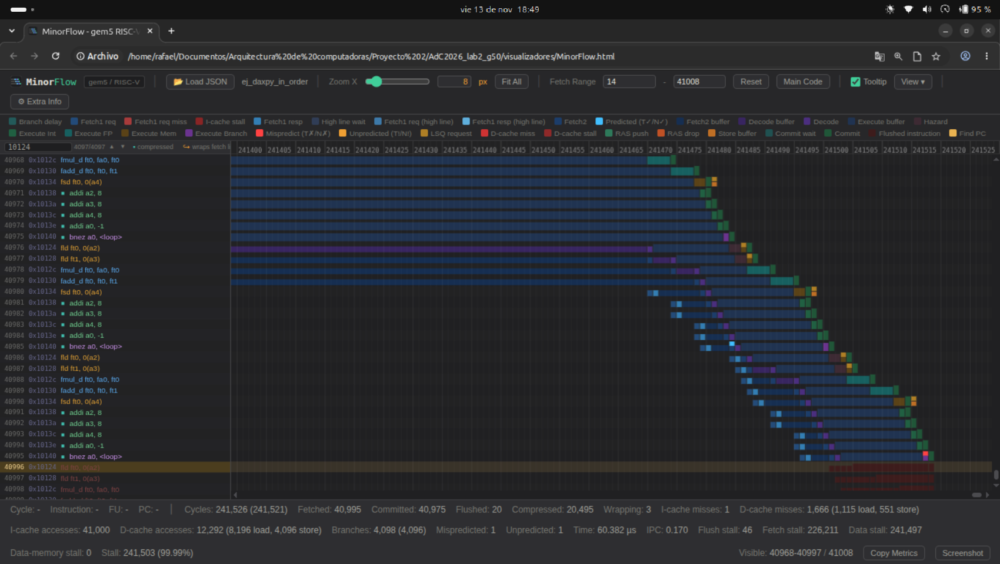

Para verificar que el loop se ejecuta 4096 veces, buscamos con Find PC la direccion
de la primera instruccion del loop (fld ft0, 0(a2), PC 0x10124) y encontro 4097
instancias. Aunque es una mas de lo esperado, la ultima aparece como Flushed
instruction, o sea que fue buscada pero nunca se ejecuto.
Esto pasa por la prediccion de saltos: como el bnez del loop se toma en 4095 iteraciones seguidas, 
el predictor de 2 bits aprende que ese salto siempre se toma y lo sigue prediciendo asi. En la ultima 
iteracion el salto no se toma, pero el procesador ya habia empezado a buscar una iteracion mas, por lo 
tanto cuando se resuelve el bnez el procesador detecta el error y lo flushea.

Podriamos hacer que el buscador de el resultado esperado modificando nuestro codigo de la siguiente manera:
```asm
loop:
    ...
    addi a0, a0, -1
    beqz a0, fin      # sale cuando a0 = 0
    j    loop
fin:
```
Pero se agrega 1 instruccion mas por iteracion, por lo que tendriamos 4096 instrucciones mas, y el error del ultimo
salto seguiria estando. Entonces decidimos dejarlo como esta.

#### Simulacion procesador in-order

##### Tamaño de datos de la cache: 8KiB con mapeo directo de 1 via. 
- Resultados: 
  - Cantidad de ciclos: 812,774
  - Misses de la cache de datos: 8,705 (4,609 load, 4,096 store)
  - Hits de la cache de datos: 3,587 (3,587 load, 0 store)
  - Miss rate: 70.82 %

##### Tamaño de datos de la cache: 8KiB, cache asociativa de 2 vias. 
- Resultados: 
  - Cantidad de ciclos: 393,149
  - Misses de la cache de datos: 2,885 (1,908 load, 977 store)
  - Hits de la cache de datos: 9,407 (6,288 load, 3,119 store)
  - Miss rate: 23.47 %

##### Tamaño de datos de la cache: 8KiB, cache asociativa de 4 vias. 
- Resultados: 
  - Cantidad de ciclos: 286,002
  - Misses de la cache de datos: 1,967 (1,345 load, 622 store)
  - Hits de la cache de datos: 10,325 (6,851 load, 3,474 store)
  - Miss rate: 16.00 %

##### Tamaño de datos de la cache: 8KiB, cache asociativa de 8 vias. 
- Resultados: 
  - Cantidad de ciclos: 251,386
  - Misses de la cache de datos: 1,705 (1,139 load, 566 store)
  - Hits de la cache de datos: 10,587 (7,057 load, 3,530 store)
  - Miss rate: 13.87 %


##### Tamaño de datos de la cache: 16KiB con mapeo directo de 1 via. 
- Resultados: 
  - Cantidad de ciclos: 805,681
  - Misses de la cache de datos: 8,705 (4,609 load, 4,096 store)
  - Hits de la cache de datos: 3,587 (3,587 load, 0 store)
  - Miss rate: 70.82 %

##### Tamaño de datos de la cache: 16KiB, cache asociativa de 2 vias. 
- Resultados: 
  - Cantidad de ciclos: 393,679
  - Misses de la cache de datos: 2,881 (1,905 load, 976 store)
  - Hits de la cache de datos: 9,411 (6,291 load, 3,120 store)
  - Miss rate: 23.44 %

##### Tamaño de datos de la cache: 16KiB, cache asociativa de 4 vias. 
- Resultados: 
  - Cantidad de ciclos: 288,000
  - Misses de la cache de datos: 1,972 (1,359 load, 613 store)
  - Hits de la cache de datos: 10,320 (6,837 load, 3,483 store)
  - Miss rate: 16.04 %

##### Tamaño de datos de la cache: 16KiB, cache asociativa de 8 vias. 
- Resultados: 
  - Cantidad de ciclos: 246,594
  - Misses de la cache de datos: 1,687 (1,126 load, 561 store)
  - Hits de la cache de datos: 10,605 (7,070 load, 3,535 store)
  - Miss rate: 13.72 %

##### Tamaño de datos de la cache: 32KiB con mapeo directo de 1 via. 
- Resultados: 
  - Cantidad de ciclos: 800,690
  - Misses de la cache de datos: 8,705 (4,609 load, 4,096 store)
  - Hits de la cache de datos: 3,587 (3,587 load, 0 store)
  - Miss rate: 70.82 %

##### Tamaño de datos de la cache: 32KiB, cache asociativa de 2 vias. 
- Resultados: 
  - Cantidad de ciclos: 378,351
  - Misses de la cache de datos: 2,864 (1,891 load, 973 store)
  - Hits de la cache de datos: 9,428 (6,305 load, 3,123 store)
  - Miss rate: 23.30 %

##### Tamaño de datos de la cache: 32KiB, cache asociativa de 4 vias. 
- Resultados: 
  - Cantidad de ciclos: 281,273
  - Misses de la cache de datos: 1,935 (1,343 load, 592 store)
  - Hits de la cache de datos: 10,357 (6,853 load, 3,504 store)
  - Miss rate: 15.74 %

##### Tamaño de datos de la cache: 32KiB, cache asociativa de 8 vias. 
- Resultados: 
  - Cantidad de ciclos: 241,534
  - Misses de la cache de datos: 1,666 (1,115 load, 551 store)
  - Hits de la cache de datos: 10,626 (7,081 load, 3,545 store)
  - Miss rate: 13.55 %


## Ejercicio 1d.

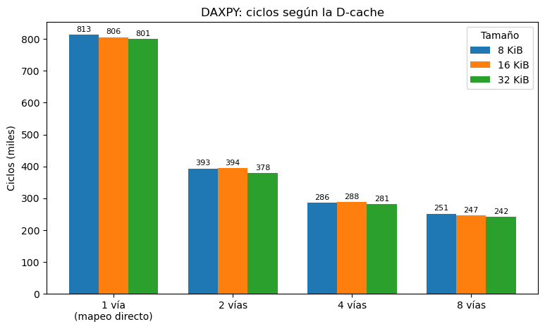

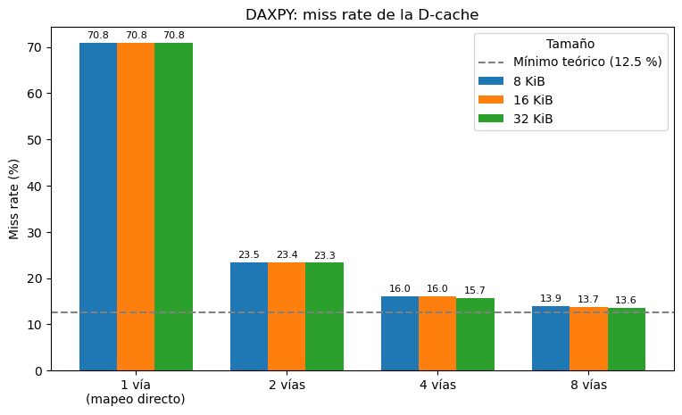

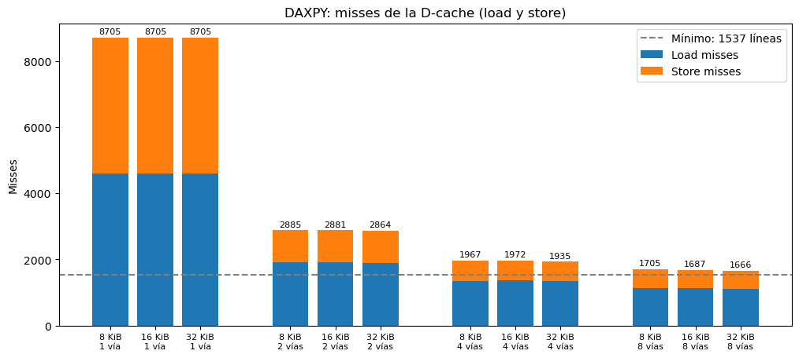

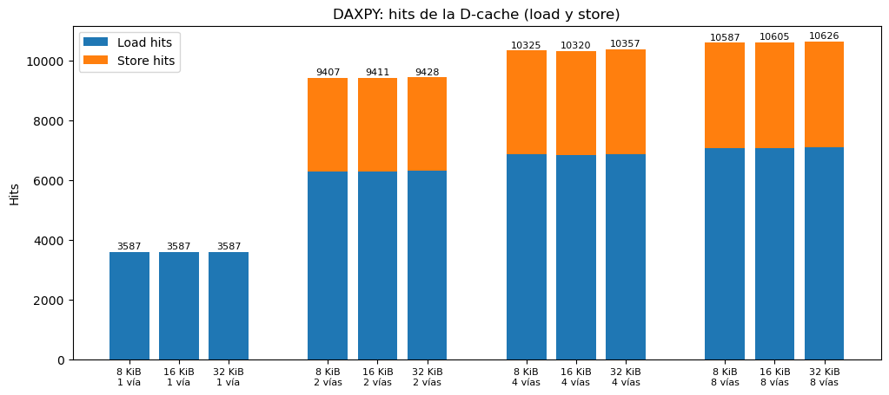

##### Conjunto de X[i], Y[i] y Z[i]

Las lineas de la cache son de 64 bytes, o sea que entran 8 doubles por linea. La cantidad de
conjuntos es tamaño / (64 * vias) y el conjunto de una direccion es (direccion / 64) mod conjuntos.

X empieza en 0x11280 (linea 1098), Y en 0x19280 y Z en 0x21280. Y y Z estan 512 y 1024 lineas despues de X, y como la cantidad de conjuntos siempre divide a 512, X[i], Y[i] y Z[i] caen
siempre en el mismo conjunto:

| Conjuntos | Configuraciones                  | Conjunto de X[i], Y[i] y Z[i] |
|---|---|---|
| 512 | 32KiB 1 via                            | (74 + i/8) mod 512 |
| 256 | 16KiB 1 via, 32KiB 2 vias              | (74 + i/8) mod 256 |
| 128 | 8KiB 1 via, 16KiB 2 vias, 32KiB 4 vias | (74 + i/8) mod 128 |
| 64 | 8KiB 2 vias, 16KiB 4 vias, 32KiB 8 vias | (10 + i/8) mod 64 |
| 32 | 8KiB 4 vias, 16KiB 8 vias               | (10 + i/8) mod 32 |
| 16 | 8KiB 8 vias                             | (10 + i/8) mod 16 |

#### Lineas minimas a traer de memoria.

Cada vector ocupa 4096 * 8 / 64 = 512 lineas, entonces hay que traer 3 * 512 = 1536 lineas, mas 1 de N y Alpha: 1537 misses como minimo. Como cada linea tiene 8 elementos, el missrate minimo es 1/8 = 12.5 %.

#### Analisis

El tamaño de la cache casi no cambia nada, porque el codigo usa cada elemento una sola vez y no hay reuso, lo que importa son las vías, por que X[i], Y[i] y Z[i] caen en el mismo conjunto.
Con 1 via cada acceso saca de la cache la linea anterior. Por eso los 4096 stores a Z son todos misses y uno de los dos loads falla siempre.
Con mas vias las tres lineas pueden estar a la vez en el conjunto. No llega al minimo porque el reemplazo de la cache es aleatorio y a veces saca una linea que todavia se esta usando, cosa que pasa menos cuantas mas vias haya. Con 8 quedamos en 13.55%, cerca del 12.5%.
Los ciclos bajan junto a las misses (de ~800.000 a ~242.000), por que el procesador in-order cada miss frena el pipeline hasta que llega la linea.

#### Comparacion entre ejecucion con 1 via y ejecucion con 8 vias

Instruccion ejecutada con 1 via:
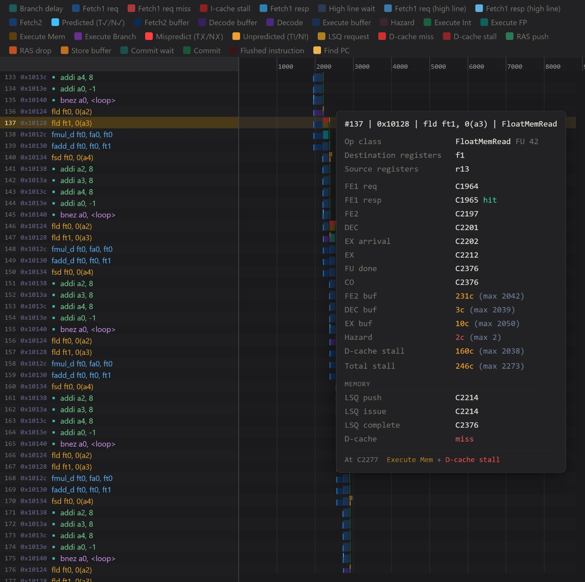

Instruccion ejecutada con 8 via:
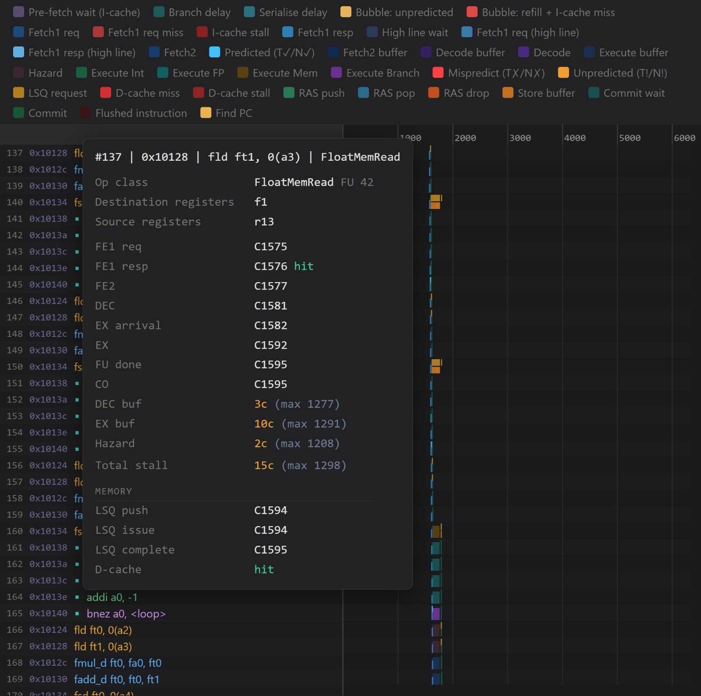


Diferencias y explicacion:

Ejecucion con 1 vía: 
Al leer X[i] en la instrucción 136, esa línea ocupó la única vía disponible del conjunto y desalojó la línea de Y[i]. Después, 137 intenta leer Y[i] y genera un miss, provocando un D-cache stall de 160 clocks (penalizacion) mientras se trae nuevamente la línea desde memoria. Al tratarse de un procesador in-order, este bloqueo impide avanzar la etapa de ejecución y commit, generando retención hacia atrás en las colas del front-end y triplicando el tiempo total de ejecución del programa (en total uno 246 clocks).

Ejecucion con 8 vías: 
Al ser 8 vias las intrucciones 136 se leyó X[i] en una vía del conjunto, mientras que la instruccion 137 se leyo Y[i] en otra via del mismo conjunto. Por ello se obtiene un hit inmediato en D-cache y completa la operación en solo 15 clocks


#### Ejercicio 1e

Para la reescritura del codigo se utilizo:
 -Loop Unrolling 4 veces para que pueda procesar en cada 32 bytes en cada iteraccion y como cada bloque es de 64 bytes se trae de memoria 2 veces 1 para los primero 4 y otra para los ultimos 4.
 -Reordenamiento de instrucciones agrupando primero las 4 cargas de X, luego las 4 cargas de Y, después las operaciones aritméticas y al final los 4 almacenamientos en Z para aprovechar 4 elementos consecutivos de cada bloque de $64\text{ B}$ antes de que el siguiente vector desaloje la línea, y además separa instrucciones dependientes para ocultar latencias de punto flotante en el pipeline in-order.
 -Tambien se renombaron registros para evitar pisar datos cargados antes de hacer operaciones y eliminar dependencias WAR y WAW

Comparaciones entre:

|---                 | 32 Kib 1 via con opt               | 32 KiB 2 vias sin opt |
|---|---|---|
|Cycles              | 318,230                            | 378,351 |
|Committed           | 25,618                             | 40,978 |
|I-cache misses      | 2                                  | 1 |
|D-cache misses      | 3,073 (2,049 load, 1,024 store)    | 2,864 (1,891 load, 973 store)|
|I-cache accesses    | 26,676                             | 41,008 |
|D-cache accesses    | 12,290 (8,194 load, 4,096 store)   | 12,292 (8,196 load, 4,096 store) |
|Branches            | 1,027                              | 4,099 |
|Mispredicted        | 1                                  | 1 |
|Unpredicted         | 3                                  | 3 |
|Time                | 79.558 µs                          | 94.588 µs |
|IPC                 | 0.081                              | 0.108 |
|CPI                 | 12.42                              | 9.23 |
|D-cache hits        | 9,217 (6,145 load, 3,072 store)    | 9,428 (6,305 load, 3,123 store) |
|D-cache miss rate   | 25.00 %                            | 23.30 % |
|I-cache miss rate   | 0.01 %                             | 0.00 % |
|Mispredict rate     | 0.39 %                             | 0.10 % |


|---                |32KiB 8 vias con opt             | 32KiB 8 vias sin opt  |
|---|---|---|
Cycles              |208,427                          | 241,534 |
Committed           |25,618                           | 40,978 |
I-cache misses      |2                                | 1 |
D-cache misses      |1,538 (1,026 load, 512 store)    | 1,666 (1,115 load, 551 store) |
I-cache accesses    |26,683                           | 41,008 |
D-cache accesses    |12,291 (8,195 load, 4,096 store) | 12,292 (8,196 load, 4,096 store) |
Branches            |1,027                            | 4,099 |
Mispredicted        |1                                | 1 |
Unpredicted         |3                                | 3 |
Time                |52.107 µs                        | 60.383 µs |
IPC                 |0.123                            | 0.170 |
CPI                 |8.14                             | 5.89 |
D-cache hits        |10,753 (7,169 load, 3,584 store) | 10,626 (7,081 load, 3,545 store) |
D-cache miss rate   |12.51 %                          | 13.55 % |
I-cache miss rate   |0.01 %                           | 0.00 % |
Mispredict rate     |0.39 %                           | 0.10 % |

#### ¿Mejora en todos los casos el codigo optimizado?

En tiempo de ejecución y fallos de datos si mejora en ambas configuraciones, pero por motivos distintos y en diferente proporción. En 1 vía la ganancia es masiva (−60.3 % en clocks y −64.7 % en fallos) porque el agrupamiento elimina los fallos por conflicto. En cambio con 8 vías la mejora es mucho más acotada (−13.7 % en clocks y −7.7 % en fallos) porque la asociatividad por hardware ya resolvía los conflictos entre vectores; la reducción de clocks proviene principalmente de ejecutar un 37.5 % menos de instrucciones de control y alcanzar el mínimo teórico de fallos forzosos.

## Ejercicio 1f.

#### Resultados comparativos: In-Order vs. Out-of-Order (D-cache de 32 KiB)

Ejecutamos tanto el código original (`ej_daxpy.s`) como el código optimizado mediante *loop unrolling* x4 (`ej_daxpy_opt.s`) en el procesador fuera de orden (`O3CPU`) con caché de datos de **32 KiB** (**1 vía** y **8 vías**), y los comparamos con los resultados obtenidos en el procesador *in-order* (`CVA6`) de los puntos c) y e):

| Código | Procesador | D-cache | Ciclos | D-cache Misses (Load / Store) | D-cache Miss Rate | Instrucciones (Committed) | IPC |
|---|---|---|---|---|---|---|---|
| Original (`ej_daxpy`) | In-Order | 32 KiB, 1 vía | 800,690 | 8,705 (4,609 / 4,096) | 70.82 % | 40,978 | 0.051 |
| Optimizado (`ej_daxpy_opt`) | In-Order | 32 KiB, 1 vía | 318,230 | 3,073 (2,049 / 1,024) | 25.00 % | 25,618 | 0.081 |
| Original (`ej_daxpy`) | In-Order | 32 KiB, 8 vías | 241,534 | 1,666 (1,115 / 551) | 13.55 % | 40,978 | 0.170 |
| Optimizado (`ej_daxpy_opt`) | In-Order | 32 KiB, 8 vías | 208,427 | 1,538 (1,026 / 512) | 12.51 % | 25,618 | 0.123 |
| Original (`ej_daxpy`) | Out-of-Order | 32 KiB, 1 vía | 121,593 | 2,346 (1,537 / 809) | 19.09 % | 40,978 | 0.337 |
| Optimizado (`ej_daxpy_opt`) | Out-of-Order | 32 KiB, 1 vía | 95,998 | 1,538 (1,025 / 513) | 12.51 % | 25,618 | 0.267 |
| Original (`ej_daxpy`) | Out-of-Order | 32 KiB, 8 vías | 114,445 | 1,538 (1,026 / 512) | 12.51 % | 40,978 | 0.358 |
| Optimizado (`ej_daxpy_opt`) | Out-of-Order | 32 KiB, 8 vías | 98,796 | 1,536 (1,024 / 512) | 12.50 % | 25,618 | 0.259 |

#### ¿Cuánto mejora el código optimizado en cada procesador?

* **En el procesador In-Order (`CVA6`)**:
  * **Con D-cache de 32 KiB, 1 vía**: los ciclos bajan de **800,690 a 318,230**, lo que representa una reducción del **60.26 %** (un *speedup* de **2.52x**). Aquí la optimización tiene un impacto enorme porque al agrupar 4 lecturas de `X` y 4 de `Y` antes de escribir en `Z`, los misses caen de 8,705 a 3,073 (25.00 %), evitando los *stalls* bloqueantes en cada acceso.
  * **Con D-cache de 32 KiB, 8 vías**: los ciclos bajan de **241,534 a 208,427**, logrando una mejora del **13.71 %** (un *speedup* de **1.16x**). Como 8 vías ya evitaban casi todos los conflictos de caché en el código original (1,666 vs. 1,538 misses), la ganancia proviene principalmente de ejecutar un **37.5 %** menos de instrucciones (`25,618` vs. `40,978`) y de eliminar los pocos desalojos aleatorios restantes.
* **En el procesador Out-of-Order (`O3CPU`)**:
  * **Con D-cache de 32 KiB, 1 vía**: los ciclos bajan de **121,593 a 95,998**, logrando una mejora del **21.05 %** (un *speedup* de **1.27x**). La mejora porcentual es menor que en *in-order* (21.05 % frente a 60.26 %) porque el `O3CPU` ya lograba esconder gran parte de los conflictos del código original adelantando cargas de iteraciones futuras antes de ejecutar los *stores*.
  * **Con D-cache de 32 KiB, 8 vías**: los ciclos bajan de **114,445 a 98,796**, una mejora del **13.67 %** (un *speedup* de **1.16x**), prácticamente idéntica en proporción a la obtenida con 8 vías en *in-order* (13.71 %), ya que en ambos casos los misses alcanzan el mínimo teórico (~12.5 %) y la ganancia responde al ahorro de instrucciones de control por el desenrollado.

#### Análisis de diferencias con Konata

* **Por qué el Out-of-Order tolera mucho mejor el código original**:
  * **En 32 KiB, 1 vía (`121,593` ciclos, `19.09 %` miss rate)**: En la captura de Konata del código original (`ej_daxpy` en `o3_32k_1via`) se observa que cuando los `fld` (`s307` y `s308`) quedan esperando los datos de memoria (barras rojas `Cm`), el `O3CPU` **no detiene el frontend**. Continúa buscando, renombrando (`Rn`) y despachando (`Is`) los `fld` de las iteraciones siguientes (`s317`–`s318` y `s327`–`s328`) por adelantado. Como los *stores* (`fsd`, como `s311` y `s321`) quedan retenidos en `Ds` esperando los resultados aritméticos (`fmul.d` y `fadd.d`), todavía no escriben en caché, permitiendo que los `fld` adelantados lean los elementos contiguos de la línea de 64 bytes antes de ser desalojada (bajando los misses de 8,705 en *in-order* a 2,346).
  * **En 32 KiB, 8 vías (`114,445` ciclos, `12.51 %` miss rate)**: En la captura de Konata de 8 vías (`ej_daxpy` en `o3_32k_8via`), al aumentar la asociatividad se eliminan por completo los desalojos por conflicto entre los tres vectores (`1,538` misses). Luego de un primer miss frío (`s259`–`s260`), las cargas de las iteraciones siguientes (`s268`–`s269`, `s278`–`s279`) resuelven sus accesos como *hits* rápidos en pocos ciclos.

  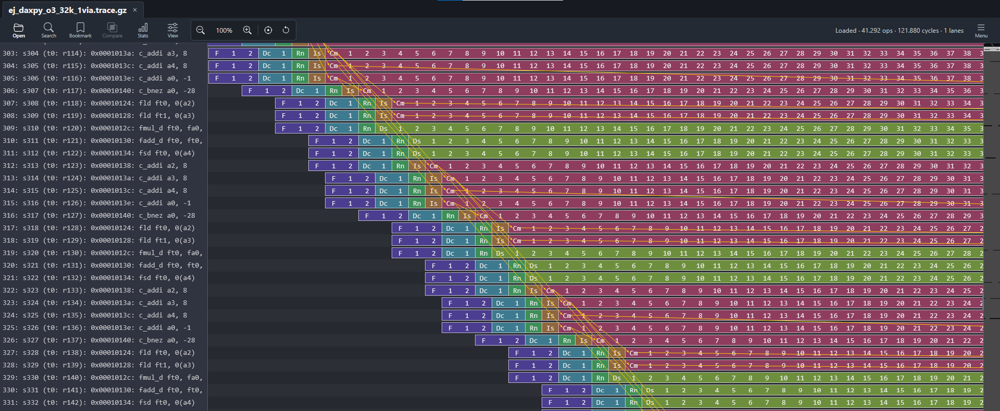
  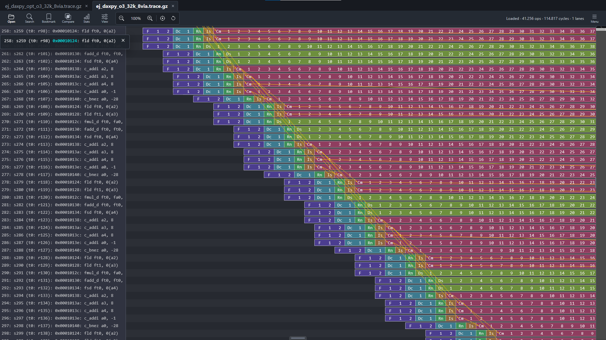

* **Impacto del código optimizado (`ej_daxpy_opt`) en Out-of-Order**:
  * **En 32 KiB, 1 vía (`95,998` ciclos, `12.51 %` miss rate)**: En Konata se observa que las cuatro cargas contiguas de `X` (`s22` a `s25`) se emiten en paralelo: la primera (`s22`) dispara el *miss* de caché y las tres siguientes (`s23`–`s25`) aprovechan la misma línea de 64 bytes mediante los MSHR sin generar nuevos misses. Lo mismo ocurre con `Y` (`s26` a `s29`), y al agrupar los `fsd` al final del bloque se evita el desalojo prematuro incluso con 1 vía (alcanzando el mínimo teórico de 1,538 misses frente a los 3,073 que aún sufría el *in-order* en 1 vía por no poder solapar iteraciones).
  * **En 32 KiB, 8 vías (`98,796` ciclos, `12.50 %` miss rate)**: Los misses alcanzan el mínimo teórico (`1,536` misses: 512 líneas de `X` + 512 de `Y` + 512 de `Z`). La pequeña diferencia de ~2,800 ciclos respecto a 1 vía responde a la latencia adicional de búsqueda de etiquetas (*tag lookup*) y gestión de reemplazo en una caché de mayor asociatividad cuando el número de misses ya es idéntico.

  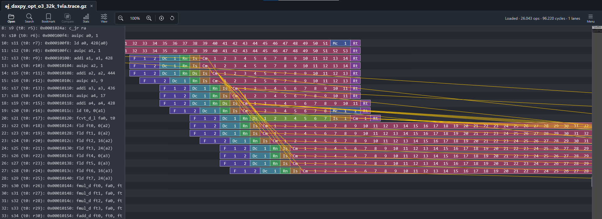
  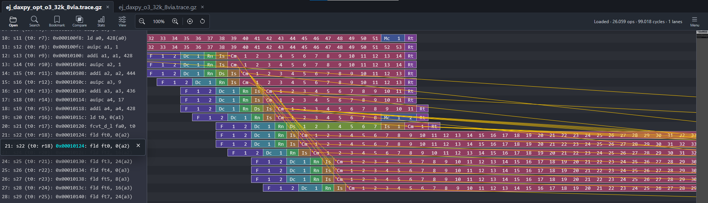


#### Ejercicio 2.


#### 2-b.

Corrimos el codigo del 2-a en el procesador in-order, con los dos predictores. El miss rate se mide (Mispredicted + Unpredicted) / Branches.

| Predictor | Activaciones | Ciclos | Miss rate |
|---|---|---|---|
| Local 2 bits    | activ_ruido  | 23,521 | 38.46 % |
| Tournament      | activ_ruido  | 21,117 | 23.78 % |
| Local 2 bits    | activ_imagen | 18,039 | 8.02 % |
| Tournament      | activ_imagen | 16,522 | 0.84 % |

Con MinorFlow contamos cuantas veces falla cada salto (de 1024 ejecuciones los tres primeros y 256 el ultimo):

| Salto | Local ruido | Tournament ruido | Local imagen | Tournament imagen |
|---|---|---|---|---|
| bge t0, zero, no_neg (x < 0) | 505 | 512 | 2 | 3 |
| bge t3, t0, no_sat (x > 6)   | 515 | 237 | 4 | 9 |
| bne t2, zero, loop_c         | 257 | 33  | 257 | 10 |
| bnez a0, loop_i              | 2   | 8   | 2 | 4 |

#### Comparación con lo deducido en el ejercicio 2-a.

Usando el predictor local los resultados dan casi igual a lo que esperamos. El bne sigue la secuendia T, T, T, N, el contador 2 bits queda como taken y falla siempre en la salida.
Con ruido los dos bge dependen de un valor cualquiera, asi que fallan mas o menos la mitad de las veces.
Con imagen los valores estan ordenados, entonces bge solo falla cuando cambian de negativo a positivo y de menor a mayor que 6.

Usando Tournament el bne del loop_c deja de fallar casi siempre, porque el predictor global usa la histroria de saltos anteriores y aprende que, despues de 3 vueltas viene la salida, por eso con respecto al de 2 bits la imagen baja a 0.84%.
Con ruido el primer bge falla, igual que antes, porque x < 0 es al azar y no hay historia previa que sirva. El segundo bge, lo hace mejor, de 515 a 237 fallos => si el primero no salto (x < 0) el codigo pone a t0 = 0 y el segundo siempre salta, entonces el predictor global lo puede ver en la historia. Cuando x >= 0 sigue siendo al azar, por eso no baja a cero.

#### Capturas con MinorFlow.

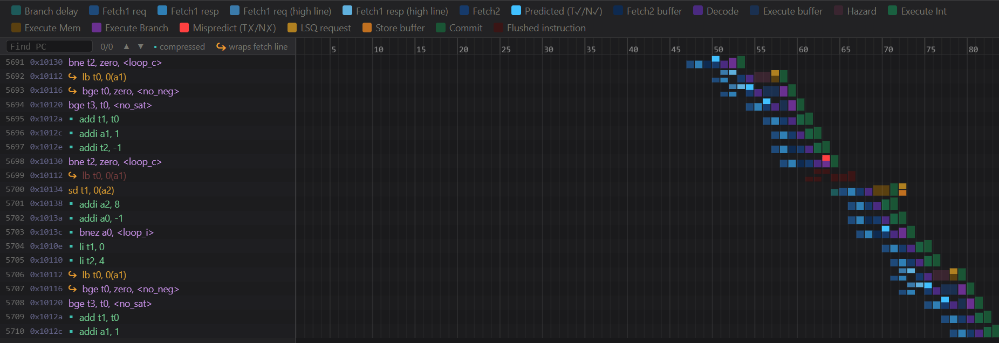

Falla el bne del loop_c en la ultima vuelta (5698) y se flushea el lb que habia buscado.

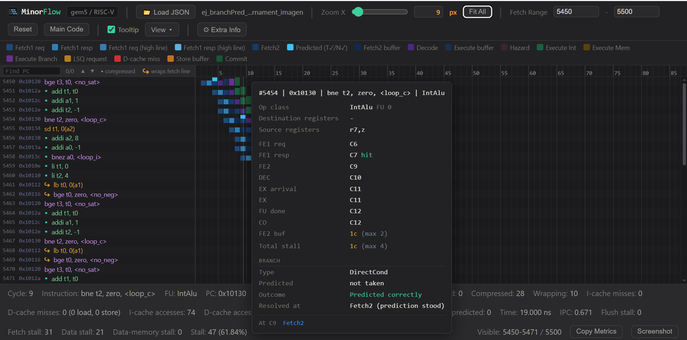

El mismo bne se predice bien (5454) y no hay flush.

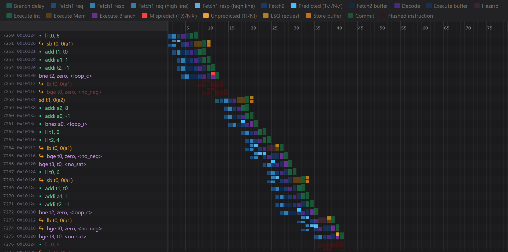

Falla el bne del loop_c (7255) y el bge de x > 6 (7275).

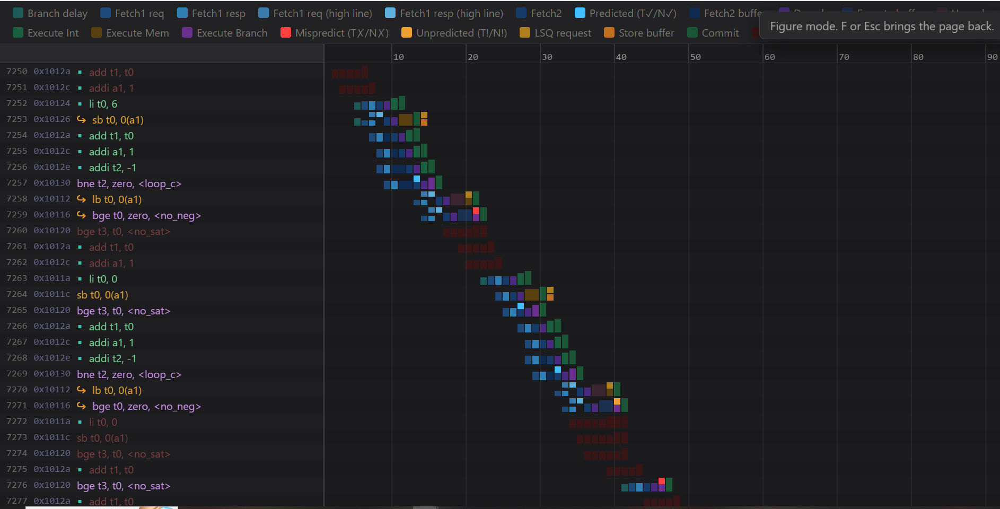

El bne del loop_c se predice bien (7257 y 7269), siguen fallando los bge que dependen del dato (7259, 7271 y 7276).

#### Ciclos.

En ciclos el tournament ahorra 2,404 con ruido 10% y 1,517 con imagen un 8%, cada salto que falla cuesta unos 5 a 6 ciclos de flush.


#### 2-c.

#### Implementación sin saltos (`ej_branchPred_sinsalto.s`)

Para eliminar los saltos condicionales que dependían del valor de cada activación en el cálculo de `ReLU6` (`x < 0` y `x > 6`), utilizamos las instrucciones de mínimo y máximo con signo de la extensión `Zbb` de RISC-V (`max` y `min`). De este modo, el clampeo al intervalo `[0, 6]` se resuelve mediante operaciones aritméticas puras sin ramificaciones:

```asm
loop_c:
	lb      t0, 0(a1)           # t0 = x[i][c]
	max     t0, t0, zero        # ReLU: t0 = max(t0, 0) sin salto
	min     t0, t0, t3          # ReLU6: t0 = min(t0, 6) sin salto
	sb      t0, 0(a1)           # guarda x[i][c] saturado en memoria
	add     t1, t1, t0          # suma += x[i][c]
	addi    a1, a1, 1           # paso al siguiente canal (1 byte)
	addi    t2, t2, -1
	bnez    t2, loop_c          # repito los 4 canales
```

De los cuatro saltos que tenía el código original, desaparecen los dos saltos dependientes de datos (`bge` de cota inferior y `bge` de cota superior), quedando únicamente los dos saltos de control de los bucles (`bnez t2, loop_c` y `bnez a0, loop_i`), lo que reduce el total de saltos ejecutados de **3,331 a 1,283** (una reducción del **61.5 %**).

#### Resultados en procesador In-Order (`CVA6`)

Corrimos la versión sin saltos en el procesador *in-order* con ambos predictores y ambos conjuntos de datos:

| Predictor | Activaciones | Ciclos (2-a con saltos) | Ciclos (2-c sin saltos) | Mejora de ciclos | Branch Miss Rate (2-a) | Branch Miss Rate (2-c) |
|---|---|---|---|---|---|---|
| Local 2 bits | `activ_ruido`  | 23,521 | 16,502 | -29.84 % (-7,019 ciclos) | 38.46 % | 20.34 % |
| Tournament   | `activ_ruido`  | 21,117 | 15,396 | -27.09 % (-5,721 ciclos) | 23.78 % | 1.40 %  |
| Local 2 bits | `activ_imagen` | 18,039 | 16,505 | -8.50 % (-1,534 ciclos)  | 8.02 %  | 20.34 % |
| Tournament   | `activ_imagen` | 16,522 | 15,391 | -6.85 % (-1,131 ciclos)  | 0.84 %  | 1.40 %  |

#### Análisis de resultados y comparación con MinorFlow

1. **Independencia respecto de los datos de entrada**:
   Al eliminar los saltos condicionales que dependían del signo y magnitud de `x[i][c]`, los ciclos y el *branch miss rate* pasan a ser **prácticamente idénticos para `activ_ruido` y `activ_imagen`** (`16,502` vs. `16,505` ciclos con Local 2 bits, y `15,396` vs. `15,391` con Tournament). El flujo de control deja de verse afectado por la aleatoriedad de los datos.

2. **Impacto según el conjunto de datos y el predictor**:
   * **Con `activ_ruido`**: la mejora es drástica en ambos predictores (**-29.84 %** con Local 2 bits y **-27.09 %** con Tournament), ya que en la versión original los dos `bge` fallaban casi la mitad de las veces al recibir valores aleatorios, provocando *flushes* constantes de 5 a 6 ciclos.
   * **Con `activ_imagen`**: aunque el porcentaje de *miss rate* global sube respecto al 2-b (por ejemplo de `8.02 %` a `20.34 %` en Local 2 bits), **la cantidad total de fallos y los ciclos igualmente disminuyen** (**-8.50 %** en Local 2 bits y **-6.85 %** en Tournament). Esto ocurre porque el denominador (`Branches`) cayó de 3,331 a 1,283 al eliminar los dos `bge` que casi nunca fallaban en `activ_imagen`, pero se ahorraron igualmente los fallos en las transiciones de signo/saturación y el overhead de evaluación de ramas.
   * **Comportamiento de los saltos restantes (`loop_c` y `loop_i`)**:
     * Con **Local 2 bits**, los únicos fallos que quedan son los **256 fallos en la salida del `loop_c`** (uno por cada fila de 4 canales, dado que el contador saturado predice *taken* en la 4ta iteración) más el fallo al salir de `loop_i` (257 mispredicted + 4 unpredicted sobre 1,283 saltos = **20.34 %**).
     * Con **Tournament**, el predictor global aprende el patrón `T, T, T, N` de las cuatro vueltas de `loop_c`, eliminando prácticamente todos los *flushes* (solo 1 mispredicted + 17 unpredicted = **1.40 %**) y ahorrando ~1,100 ciclos adicionales respecto a Local 2 bits.

3. **Capturas con MinorFlow**:

   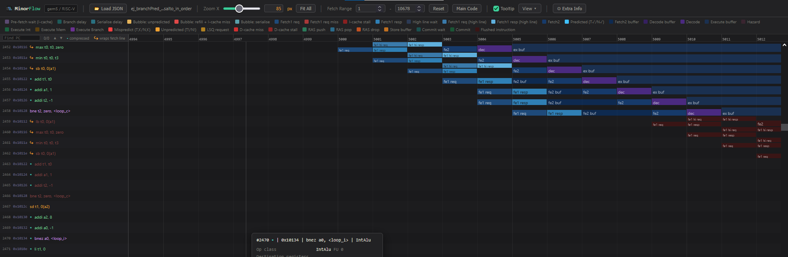

   En la traza de **Local 2 bits**, se observa que dentro del cuerpo del canal (`2452` a `2457`: `max`, `min`, `sb`, `add`, `addi`) las instrucciones avanzan sin interrupciones ni saltos, produciéndose únicamente el *flush* (instrucciones en rojo oscuro `2459`–`2465`) cuando `bnez t2, loop_c` (`2458`) falla en la cuarta iteración antes de saltar a `sd t1, 0(a2)`.

   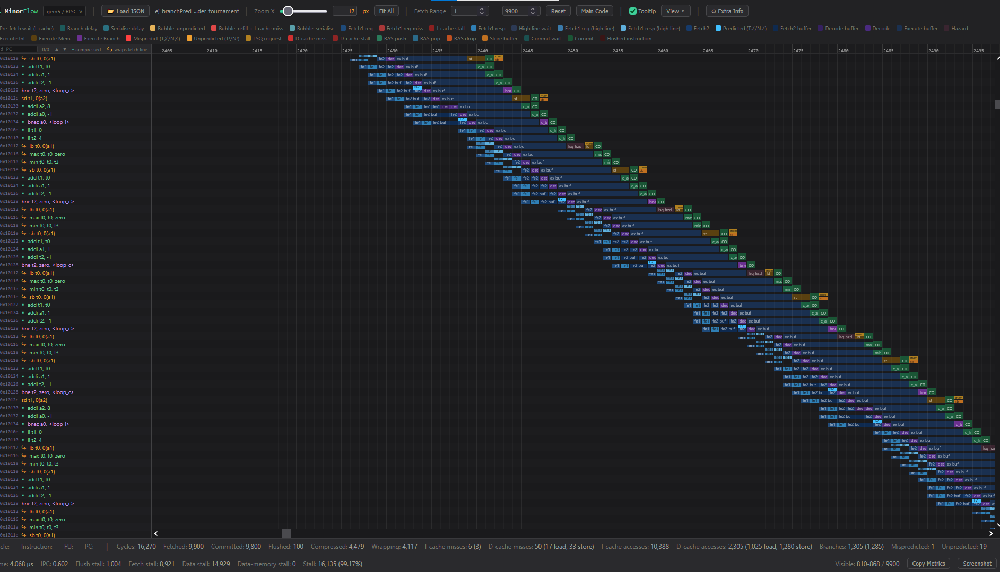

   En la traza de **Tournament**, se observa una iteración completa de `loop_i` (`4811` a `4849`) donde tanto las vueltas internas de `loop_c` (`4818`: *Predicted correctly*) como la salida en la cuarta vuelta (`4845`) se predicen correctamente, logrando una ejecución limpia sin ninguna instrucción flusheada.


#### 2-d.

#### Resultados en procesador Out-of-Order (`O3CPU`)

Ejecutamos tanto la versión original con saltos (`ej_branchPred.s`) como la versión sin saltos (`ej_branchPred_sinsalto.s`) en el procesador fuera de orden (`O3CPU`) con ambos predictores (`Local 2 bits` y `Tournament`) y ambos conjuntos de datos (`activ_ruido` y `activ_imagen`):

| Código | Predictor | Activaciones | Ciclos | Branch Miss Rate | Instrucciones (Committed) | IPC |
|---|---|---|---|---|---|---|
| Con saltos (`2-a`) | Local 2 bits | `activ_ruido`  | 26,088 | 38.50 % | 10,697 | 0.410 |
| Con saltos (`2-a`) | Tournament   | `activ_ruido`  | 20,729 | 23.78 % | 10,697 | 0.516 |
| Sin saltos (`2-c`) | Local 2 bits | `activ_ruido`  | 13,676 | 20.44 % | 9,741  | 0.712 |
| Sin saltos (`2-c`) | Tournament   | `activ_ruido`  | 11,559 | 1.33 %  | 9,741  | 0.843 |
| Con saltos (`2-a`) | Local 2 bits | `activ_imagen` | 13,991 | 8.14 %  | 10,697 | 0.765 |
| Con saltos (`2-a`) | Tournament   | `activ_imagen` | 11,297 | 0.78 %  | 10,697 | 0.947 |
| Sin saltos (`2-c`) | Local 2 bits | `activ_imagen` | 13,690 | 20.51 % | 9,741  | 0.712 |
| Sin saltos (`2-c`) | Tournament   | `activ_imagen` | 11,532 | 1.33 %  | 9,741  | 0.845 |

#### Análisis de resultados y comparación con Konata

1. **Mayor penalización por *misprediction* en Out-of-Order (caso `activ_ruido` con saltos)**:
   * Un resultado muy llamativo ocurre al ejecutar el código con saltos y `activ_ruido` usando `Local 2 bits`: en el procesador *out-of-order* tarda **26,088 ciclos**, resultando incluso **más lento que en el procesador *in-order* (`23,521` ciclos)** a pesar de tener el mismo *miss rate* (~38.5 %, 1,282 fallos).
   * Esto se debe a que el `O3CPU` posee un *frontend* ancho (3 instrucciones por ciclo) y un pipeline más profundo (`fetchToDecodeDelay = 3`, `decodeToRenameDelay = 2`, ventana de 48 instrucciones). Cuando un salto falla en el *out-of-order*, no solo se pierden 5 o 6 ciclos como en `CVA6`, sino que se descartan decenas de instrucciones especulativas que ya estaban en vuelo en el ROB (*Reorder Buffer*), generando una penalización de **~10 a 12 ciclos por cada fallo** que anula por completo la ventaja de la ejecución superescalar.

2. **Impacto de eliminar los saltos (`ej_branchPred_sinsalto.s`) en Out-of-Order**:
   * **Con `activ_ruido`**: al eliminar los saltos dependientes de datos, los ciclos se reducen en un **47.58 %** con `Local 2 bits` (de 26,088 a **13,676 ciclos**) y en un **44.24 %** con `Tournament` (de 20,729 a **11,559 ciclos**), casi duplicando el IPC (de 0.516 a **0.843**). Al igual que en *in-order*, el rendimiento se vuelve completamente independiente de los datos de entrada (`11,559` ciclos con ruido vs. `11,532` ciclos con imagen).
   * **Con `activ_imagen`**: cuando los datos son predecibles, la versión con saltos y `Tournament` logra **11,297 ciclos** (IPC = **0.947**), superando levemente a la versión sin saltos (`11,532` ciclos). Esto ocurre porque con `activ_imagen` los `bge` casi nunca fallan (0.78 % de *miss rate*), y cuando `x[i][c] >= 0` o `x[i][c] <= 6`, el código original salta por encima del `sb` y evita escribir en memoria (`1,246` stores frente a `1,280` en la versión sin saltos, que siempre ejecuta `max`, `min` y `sb` incondicionalmente). En cambio, con `Local 2 bits` la versión sin saltos sigue siendo más rápida (`13,690` vs. `13,991` ciclos) porque evita los fallos en las transiciones de signo y saturación.

3. **Comparación visual con Konata (`activ_ruido` + `Tournament`)**:

   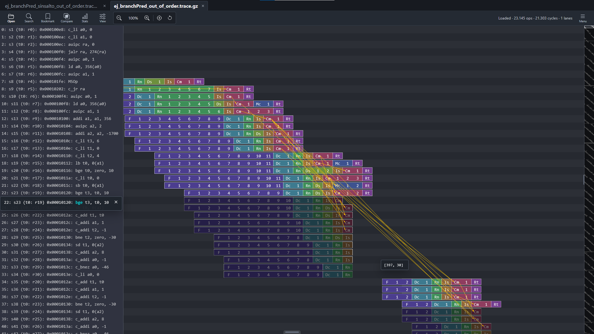

   En la traza de Konata del código con saltos (`ej_branchPred`), se observa cómo al fallar el salto `bge t3, t0, 10` (`s24`, marcado con `X`), todas las instrucciones buscadas especulativamente detrás de él (`s25` a `s34`, 10 instrucciones de las iteraciones siguientes) aparecen en gris oscuro (*flushed*), dejando un hueco vacío de **11 ciclos** (líneas amarillas) hasta que el *frontend* vuelve a emitir la instrucción correcta (`s35: add t1, t0`).

   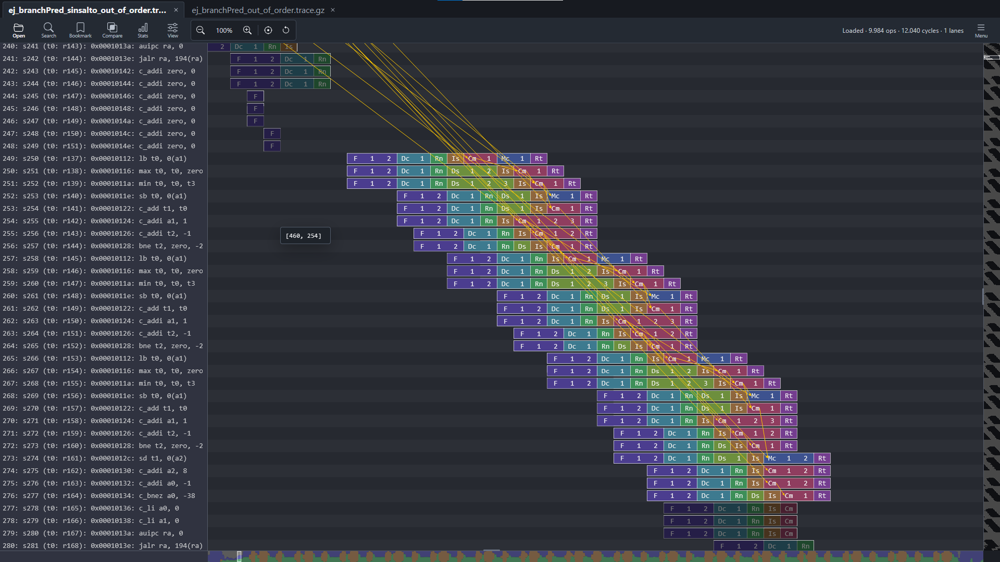

   En cambio, en la traza de Konata del código sin saltos (`ej_branchPred_sinsalto`), se observa una iteración externa completa (`s250` a `s277`, abarcando los 4 canales con `max` y `min`) avanzando en escalera continua a 3 instrucciones por ciclo, sin *flushes* internos y aprovechando toda la ventana de ejecución fuera de orden.
